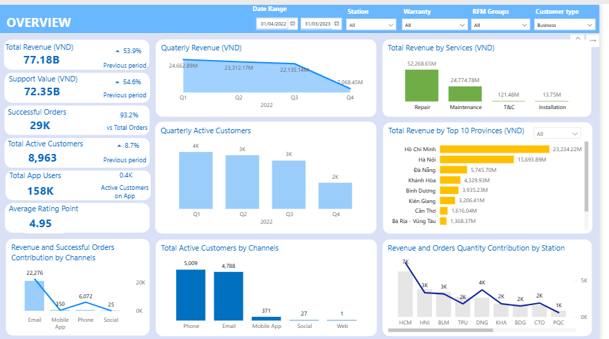
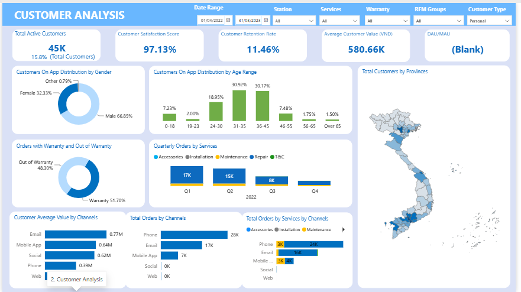
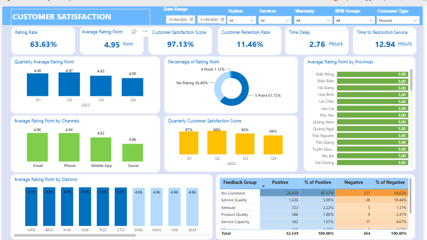
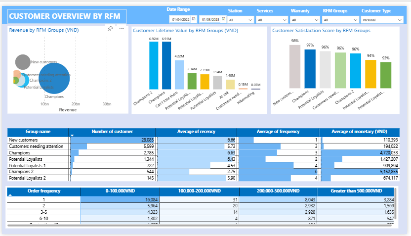
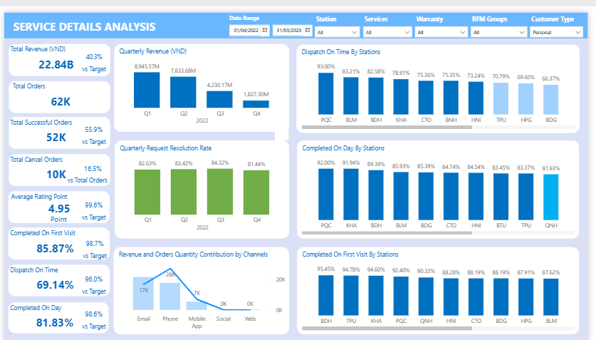

# 📊 Customer Insight Dashboard


A Power BI dashboard for the customer service app of a household appliance service company (client confidential, 2023). It shows which customers are most valuable, whether they stay, how satisfied they are and where service operations fall short, so the team can target outreach and protect service quality.

Power BI, DAX, RFM analysis, K-Means clustering

Period analysed: April 2022 to March 2023. Customer-level pages (02 to 05) are filtered to personal customers.

Dashboard file: [View exported file](https://drive.google.com/file/d/1BdVWX5p5oncMbj2wIbuwNW_MYGzRqAi8/view?usp=sharing)

---

## Business problem

The company handled about 62,000 service orders in the period, through phone, email and its mobile app. Management needed answers to a few practical questions:

- Which customers bring the most value, and which ones are at risk of leaving?
- Do customers come back after their first order?
- Are customers satisfied, and what do the unhappy ones say?
- Which stations and channels deliver good service, and where does it break down?

Without answers, outreach could not be targeted and service quality was hard to monitor.

## What I did

- Prepared customer, order and feedback data and built the KPIs as DAX measures: revenue, orders, satisfaction, retention rate, DAU/MAU, resolution time, dispatch on time and first-visit completion.
- Segmented customers by Recency, Frequency and Monetary value (RFM) and grouped them with K-Means, so each group could be compared on revenue, lifetime value and satisfaction.
- Built a five-page dashboard: overview, customer analysis, satisfaction, RFM groups and service details.
- I led the analytical work and the Power BI team, and turned the results into the insights and recommendations below.

## Key insights

1. **A small group of customers carries the value.** Champions (2,785 customers) spend about 4.7 million VND each on average and have a lifetime value of about 6.9 million VND. The largest group by far is new customers (28,085), who have ordered once and spent about 110,000 VND on average.
2. **Customers are happy but few come back.** Satisfaction is 97.13% and the average rating is 4.95 out of 5, yet the customer retention rate is only 11.46%.
3. **Phone brings the volume, email and the app bring the value.** Phone handled about 28,000 orders against 17,000 by email and 7,000 by the app. But the average customer value is 0.77 million VND for email and 0.64 million for the app, against 0.39 million for phone.
4. **Problems are rare but poorly explained.** Only 364 of about 32,900 pieces of feedback were negative (1.1%). Service quality is the most common reason, but about 60% of negative feedback has no comment. Also, 36% of customers leave no rating at all.
5. **Dispatch on time is the weakest service KPI.** It is 69.14%, against 85.87% for first-visit completion and 81.83% for same-day completion. By station it ranges from 66% to 93%. 16.5% of orders were cancelled.
6. **Revenue fell through the period.** Quarterly revenue dropped from 8.9 billion VND in Q1 to 1.8 billion VND in Q4, and order volume fell with it.

## Recommendations

1. **Turn one-time customers into repeat customers.** Follow up first orders with warranty or maintenance reminders and offers, starting with the RFM groups that are slipping away.
2. **Look after the highest-value customers.** Give Champions priority scheduling and proactive service, because losing a few of them costs far more than losing a new customer.
3. **Move phone customers to the app and email.** These channels already bring higher-value customers, and shifting volume would ease pressure on the phone line.
4. **Fix on-time dispatch first.** Use the best stations (around 93%) as the benchmark and review the stations near 66% to 71% for scheduling and capacity problems.
5. **Find out why orders are cancelled.** One in six orders was cancelled, so record a cancellation reason and review it by station and channel.
6. **Collect more feedback.** Prompt customers for a rating, and ask for a short comment when the rating is low, so negative feedback can be acted on.

## Dashboard pages

### 01 Overview


Revenue, successful orders, active customers, app users, revenue by service and province, and quarterly trends.

### 02 Customer analysis


Active customers, satisfaction, retention, average customer value, age and gender, warranty status, and orders by channel and service.

### 03 Customer satisfaction


Ratings, satisfaction score, resolution time, quarterly trends, ratings by channel and station, and positive and negative feedback.

### 04 Customer overview by RFM


Customer groups compared by revenue, lifetime value, satisfaction, size, recency, frequency and spend.

### 05 Service details


Revenue, orders, cancellations, rating, first-visit completion, dispatch on time, same-day completion and resolution rate by station and channel.

## Data confidentiality

This project was completed for a confidential client. The company name is anonymised, and the original customer data and any personal information are not included in this repository. It contains only the dashboard screenshots and the analysis.

## Repository structure

```text
Customer-Insight-Dashboard/
  README.md
  Screenshots/
    01-dashboard-overview.png
    02-customer-analysis.png
    03-customer-satisfaction.png
    04-rfm-groups.png
    05-service-analysis.png
```

